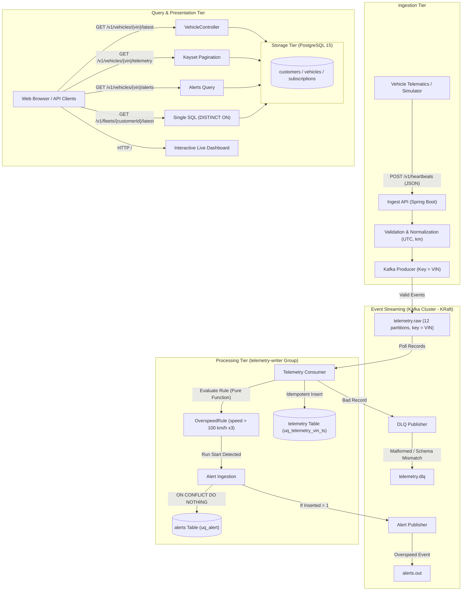

# Fleet Telemetry Platform — Bootcamp Starter Kit

Build a small version of a connected-car data platform in one day: vehicles send signals → your **Ingest API** → **Kafka** → your **consumer** → **Postgres** → your **query APIs** and **alerts**.

Pick **one** track: `java/` (Spring Boot 3, Java 17) or `python/` (FastAPI, Python 3.10+). Everything else is shared.

```
 device simulator ──HTTP──▶ Ingest API ──▶ Kafka: telemetry.raw (12 partitions, key = VIN)
                                                   │
                                                   ▼
                    Query API ◀── Postgres ◀── Consumer (group telemetry-writer) ──▶ telemetry.dlq (bad messages)
                                                   │
                                                   └──▶ alerts table + Kafka: alerts.out
```

---

## 0. Before Day 1 (pre-work — do this at home, the images are ~1.5 GB)

1. Install **Docker Desktop**, **git**, **Python 3.10+** (needed for the simulator on both tracks; macOS ships 3.9 as `python3`, so install a newer one, e.g. `brew install python@3.12`).
   Java track: **JDK 17+** (21 LTS recommended) and **Maven** (or IntelliJ IDEA, which bundles Maven).
2. Clone this repo, then from the repo root:
   ```bash
   docker compose up -d          # Kafka, Kafka UI, Postgres (+ seed data)
   ./scripts/check_env.sh        # must end with ALL GOOD
   ```
3. Start your track's app once (see §2) and open http://localhost:8080/health → `{"status":"UP"...}`.
4. Open Kafka UI at http://localhost:8081 — you should see topics `telemetry.raw`, `telemetry.dlq`, `alerts.out`.
5. Send your trainer a screenshot of `ALL GOOD` + the health response.

Windows: run the scripts from Git Bash or WSL.

---

## 1. What's already done for you

| Given | Where |
|---|---|
| Kafka (KRaft), Kafka UI, Postgres 15 with schema + ~56k telemetry rows | `docker-compose.yml`, `db/init/` |
| 200 vehicles across 12 customers (customer 1 = big fleet) | `data/vehicles.csv` |
| Device simulator (no pip install needed) | `simulator/simulate.py` |
| Kafka helper commands (topics, consume, lag) | `scripts/kafka.sh` |
| App skeleton: config from env vars, DB pool, Kafka producer/consumer wiring, `/health`, one passing test, 400 error format | `java/` or `python/` |

**Not done (that's your job):** validation, normalisation, publishing, the consumer's DB writes, idempotency, DLQ, query APIs, alerts, tests.

---

## 2. Run your app

**Python**
```bash
cd python
python3 -m venv .venv && source .venv/bin/activate      # Windows: .venv\Scripts\activate
pip install -r requirements.txt
uvicorn app.main:app --reload --port 8080               # terminal 1: API
python -m app.consumer                                  # terminal 2: consumer (from M2)
pytest -q                                               # tests
```

**Java**
```bash
cd java
mvn spring-boot:run          # API + consumer in one process on :8080
mvn test                     # tests
```

Config comes from environment variables: `DB_HOST DB_PORT DB_NAME DB_USER DB_PASSWORD KAFKA_BOOTSTRAP OVERSPEED_KMPH`. Defaults point at docker compose.

---

## 3. Milestones (Day 2)

Commit after every milestone: `git commit -m "M1: ingest API with validation"`.

### M1 — Ingest API · **no AI tools** · 60 min
`POST /v1/heartbeats`
```json
{"vin":"1FA6CVNCNCXW927TC","ts":"2026-10-28T10:00:00Z","speed_kmph":54.2,"odometer":10234.5,
 "odometer_unit":"km","lat":12.97,"lon":77.59,"heading":90,"soc_pct":null,"ignition":true,"source_oem":"OEM-A"}
```
- Validate: VIN = 17 chars A–Z/0–9 without I, O, Q · `ts` has a timezone and is not > 5 min in the future · speed 0–300 · lat/lon ranges · odometer ≥ 0 · unit `km`/`mi`.
- Invalid → **400** `{"error":"validation_failed","details":[{"field":"vin","message":"..."}]}` and nothing is published.
- Normalise → `TelemetryEvent` (schema `v1`, odometer in **km**, time in **UTC**; OEM-B devices send miles).
- Publish JSON to `telemetry.raw`, **keyed by VIN**. Return **202**.
- ≥ 2 tests.

✅ Check: `python3 simulator/simulate.py --mode malformed` → every line 400 · `python3 simulator/simulate.py --vehicles 5 --count 5` → all 202 · messages visible in Kafka UI.

### M2 — Consumer → Postgres · 75 min (AI allowed from here — you must be able to explain every line)
- Consume `telemetry.raw` (group `telemetry-writer`), write to `telemetry`.
- **Idempotent**: the same `(vin, ts_utc)` twice → one row (look at the table constraints).
- Unparseable / wrong-schema message → publish to `telemetry.dlq` and continue. One bad message must never block a partition.
- Commit the Kafka offset **after** the DB commit.

✅ Check: `python3 simulator/simulate.py --mode duplicate --vehicles 5 --count 10` → row count grows by 50, not 100.
`./scripts/kafka.sh lag` → LAG 0 on all partitions. Run `EXPLAIN` on a `(vin, ts_utc)` range query in psql: does it use the index?

### M3 — Query APIs + alerts · 45 min
| Endpoint | Notes |
|---|---|
| `GET /v1/vehicles/{vin}/latest` | 404 + error body if none |
| `GET /v1/vehicles/{vin}/telemetry?from=&to=&limit=&cursor=` | keyset pagination on `ts_utc` → `next_cursor` (no OFFSET) |
| `GET /v1/vehicles/{vin}/alerts` | newest first |
| `GET /v1/fleets/{customer_id}/latest` | latest position of every active vehicle — **one** SQL query |

**Overspeed alert:** speed > 100 km/h for 3 consecutive pings → exactly **one** `OVERSPEED` row in `alerts` per run (+ message on `alerts.out`). Write the rule as a pure function and unit-test: exactly 100, run of 2, run broken by a slow ping, run that keeps growing.

✅ Check: `python3 simulator/simulate.py --mode overspeed` → one alert.

**Rules for AI:** write 3 tests by hand first · review every AI diff · reject at least one AI suggestion and note why in your README.

### Pod extension (pick the one your mentor assigns)
1. Geofence enter/exit alerts · 2. EV charging-session detection from `soc_pct` (OEM-D) · 3. Odometer anomaly (decrease or > 2,000 km/day) + daily billing export · 4. Customer webhook notifications with retries, exponential backoff and an `event_id` for de-duplication.

### M4 — Ship it (Production Architecture & Documentation)

#### 1. High-Level Design (HLD) Architecture



#### 2. Database Schema

The platform runs on PostgreSQL 15 with strict normalization, relational integrity, and unique constraints for idempotency:

| Table | Primary Key | Key Indices & Constraints | Description |
|---|---|---|---|
| `customers` | `id SERIAL` | `name UNIQUE`, `CHECK (status IN ('active', 'churned'))` | Multi-tenant customer accounts (fleets, rentals, lenders). |
| `vehicles` | `vin CHAR(17)` | `FOREIGN KEY (customer_id)`, `idx_vehicles_customer` | Provisioned vehicles with OEM and model year metadata. |
| `devices` | `id SERIAL` | `FOREIGN KEY (vin)` | Physical telematics hardware, firmware, and last-seen heartbeat. |
| `subscriptions` | `id SERIAL` | `FOREIGN KEY (customer_id, vin)` | Active/expired customer subscription plans per vehicle. |
| `telemetry` | `id BIGSERIAL` | `uq_telemetry_vin_ts UNIQUE (vin, ts_utc)` | Time-series vehicle telemetry observations (speed, odometer, GPS coordinates, heading, ignition, SoC). The composite unique constraint doubles as an index for blazing-fast keyset pagination. |
| `alerts` | `id BIGSERIAL` | `uq_alert UNIQUE (vin, type, started_at)` | Domain alerts generated by stream consumers. The unique constraint prevents duplicate alerts for ongoing multi-ping events. |

#### 3. Three Architectural Trade-Offs

1. **Keyset Pagination vs. Offset Pagination (`LIMIT / OFFSET`)**:
   - *Decision:* Implemented cursor-based keyset pagination on `ts_utc ASC` returning `next_cursor` without `OFFSET`.
   - *Rationale:* With high-velocity telemetry tables containing millions of rows, `OFFSET N` requires PostgreSQL to scan and discard $N$ rows, causing quadratic performance degradation ($O(N)$) and high disk I/O. Keyset pagination uses the `(vin, ts_utc)` B-Tree index to jump directly to the target timestamp ($O(\log N + K)$), providing constant response times regardless of page depth.
   - *Trade-off:* Clients cannot jump to arbitrary page numbers (e.g., "go to page 50"), but fleet data inspection is inherently sequential.

2. **Kafka Partitioning Key by `VIN` vs. Random / Round-Robin**:
   - *Decision:* Partitioned all incoming heartbeats on `telemetry.raw` with `key = VIN`.
   - *Rationale:* Multi-ping rules (like `OverspeedRule`, requiring 3 consecutive pings > 100 km/h) and odometer monotonicity checks require strict per-vehicle chronological order. By keying on `VIN`, Kafka guarantees all signals from a vehicle are routed to the exact same partition and consumed sequentially.
   - *Trade-off:* Uneven partition distribution if one enterprise fleet has significantly more active vehicles or higher transmission frequencies. This is mitigated by having 12 partitions and uniform hashing.

3. **At-Least-Once Delivery with DB Idempotency vs. Distributed Transactions (XA / 2PC)**:
   - *Decision:* Configured Kafka consumer with manual offset commit executed strictly after database write, backed by `ON CONFLICT (vin, ts_utc) DO NOTHING` and `ON CONFLICT (vin, type, started_at) DO NOTHING`.
   - *Rationale:* Two-phase commit (XA) across Kafka and PostgreSQL adds significant coordination latency, network round-trips, and locks. At-least-once delivery with DB-level unique constraints provides bulletproof deduplication at wire speed without distributed locking.
   - *Trade-off:* Re-delivered duplicate messages still incur a database index lookup, but return zero inserted rows safely and commit without side-effects.

#### 4. What Broke & How We Fixed It

- **Spring Boot Constructor Injection Ambiguity (Production Deployment Crash)**:
  - *Symptom:* Container failed on Render with `NoSuchMethodException: com.fleetbootcamp.telemetry.service.IngestService.<init>()`.
  - *Root Cause:* `IngestService` contained an overloaded constructor for testing alongside its primary dependency-injected constructor. Spring's reflection could not determine which constructor to instantiate.
  - *Fix:* Added explicit `@Autowired` annotation to the primary constructor and verified startup across mock and containerized environments.
- **Port 5432 Host Collision**:
  - *Symptom:* `docker compose up` failed to start PostgreSQL due to `bind: address already in use` from an existing local database container.
  - *Fix:* Mapped `fleet-postgres` to host port `5433:5432` in `docker-compose.yml`, while keeping internal Docker network port `5432`, and made `DB_PORT: 5433` default in `application.yml`.
- **Dynamic Cloud Port Binding (`$PORT`)**:
  - *Symptom:* Render and cloud PaaS environments assign a dynamic HTTP port via the `$PORT` environment variable; fixed port 8080 caused HTTP health check timeout.
  - *Fix:* Configured `server.port: ${PORT:8080}` in `application.yml` and exposed port 8080 in the multi-stage Dockerfile.
- **Rejected AI Suggestion**:
  - *Rejected Proposal:* An AI suggestion suggested querying all vehicles for a customer and looping in Java code to execute `findLatest(vin)` for each vehicle to serve `GET /v1/fleets/{customerId}/latest`.
  - *Why Rejected:* For a fleet with 10,000 vehicles, this introduces the classic $N+1$ query problem, resulting in 10,001 database network round-trips and connection pool exhaustion. We rejected this and implemented a single, highly-optimized SQL query using PostgreSQL's `DISTINCT ON (v.vin)` combined with an index scan:
    ```sql
    SELECT DISTINCT ON (v.vin) v.vin, t.ts_utc, t.speed_kmph, t.odometer_km, t.lat, t.lon, t.heading, t.soc_pct, t.ignition, t.source_oem
    FROM vehicles v
    JOIN telemetry t ON t.vin = v.vin
    WHERE v.customer_id = ? AND v.status = 'active'
    ORDER BY v.vin, t.ts_utc DESC;
    ```

#### 5. Scaling to 10× Load (Architecture Roadmap)

To scale from current workloads to 10× volume (~500,000 active vehicles, ~50,000 heartbeats/second):
1. **Kafka Partitioning & Consumer Parallelism**:
   - Scale `telemetry.raw` from 12 to 48 partitions.
   - Horizontally scale the consumer application to 24–48 instances within the `telemetry-writer` consumer group, ensuring 1:1 or 1:2 partition-to-consumer core mapping.
2. **Database Batching & Write Optimization**:
   - Replace single-row JDBC inserts with micro-batch inserts (`rewriteBatchedStatements=true` in PostgreSQL JDBC driver) or buffer messages in memory for 100ms / 500 records before issuing `executeBatch()`, reducing DB IOPS by 80–90%.
3. **Database Read/Write Splitting & Connection Pooling**:
   - Deploy `pgBouncer` in transaction-pooling mode in front of PostgreSQL to handle thousands of concurrent queries without process starvation.
   - Route all read endpoints (`GET /v1/vehicles/...`, `GET /v1/fleets/...`) to read replicas, keeping the primary PostgreSQL node dedicated exclusively to ingest writes.
4. **Time-Series Partitioning (TimescaleDB / Native Declarative Partitioning)**:
   - Convert `telemetry` table to monthly range partitions (e.g., `telemetry_2026_10`).
   - Keeps B-Tree index working sets smaller than server RAM, eliminating index cache thrashing. Data retention policies can drop old partitions in $O(1)$ time without running slow, locking `DELETE` queries.
5. **Caching Active Vehicle State in Redis**:
   - Maintain the latest telemetry ping per vehicle in a Redis Hash (`HSET vehicle:latest:{vin}`).
   - `GET /v1/vehicles/{vin}/latest` and `GET /v1/fleets/{customerId}/latest` can be served in sub-millisecond time directly from Redis cache without hitting disk.


---

## Day 3 — SQL and data-fix practice

On the **morning of Day 3**, before the first session, run from the repo root (with `docker compose up -d` running):
```bash
./scripts/day3_setup.sh
```
It keeps your Day 2 data and adds what Day 3 needs: recent readings for the time-based questions, a few planted data problems, and your tickets. Running it again is safe (it says "already applied" and changes nothing).

- **Tickets** are in the `ops_tickets` table: `docker compose exec postgres psql -U fleet -d fleet -c 'select id, title, body from ops_tickets order by id'`
- **Files** are in `data/day3/`: `transfer_cityride_to_autofin.csv` (ticket FIX-3) and `app.log` (log task: count errors per service in the hour ending at the last line, `2026-10-27T10:00:00Z`).
- Follow the safe steps for every fix: SELECT and count first, back up, change inside a transaction, check, then commit.

`./scripts/day3_setup.sh --reset` rebuilds the database from scratch and then applies the Day 3 setup. **It deletes your Day 2 data**, so use it only if your database is broken.

---

## 4. Useful commands
```bash
./scripts/kafka.sh consume telemetry.raw     # see messages + partition + key
./scripts/kafka.sh consume telemetry.dlq
./scripts/kafka.sh lag                       # consumer lag per partition
docker compose exec postgres psql -U fleet -d fleet
docker compose down -v && docker compose up -d   # full reset (re-seeds the DB)
```

## 5. Questions you should be able to answer
Why key by VIN? What if one huge fleet's vehicles all hash to one partition? At-least-once vs exactly-once — which do you have, and why is it OK? How do you notice consumer lag? What happens with out-of-order timestamps? How would you store a year of data (hot vs cold)? How do you scale the consumer? What would you monitor and alert on?

> This is a **training project**. On your resume, describe it honestly (e.g. "Fleet Telemetry Platform — bootcamp project; built X, owned Y").
